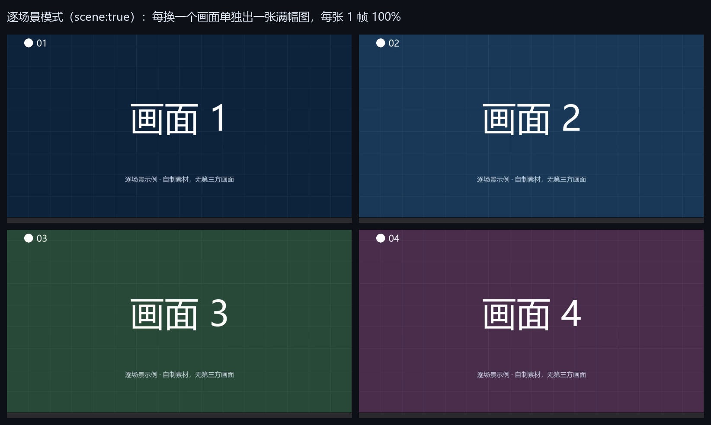

# See Now More · 和 DSH 聊天，也跟它开着一路视频

> 像在 QQ 里点了视频通话：那一路画面是你的屏幕，那一路声音是你的音箱；
> 消息发出去就插队 —— 它还在思考，下一步也会接住你这句话。

> **包名 `dsh-see-now-more`，仓库 [nacivageer/dsh-see-now-more](https://github.com/nacivageer/dsh-see-now-more)。**
> `dsh-see-now` 回答的是**「多久看一次」**——采样间隔、变化分、档位。这一仓补的是它没回答的那半句：
> **「什么时候该看、什么时候该听」**。聊天窗、悬浮窗是这条判断的外壳（也是日常在用的大半），
> 听觉是它的输入。本体是**黑听抬头**：默认只听，听到值得抬眼的内容才抬头看一眼，看完自己收回去。
> 上游把这件事交给参数，这里把判断权拿回来——这是它能叫 `more` 的唯一理由。
> **不是一键安装**——没有发布到 npm，只能从源码装，面向 DSH 桌面版用户和愿意读代码的人。

- **聊天**：气泡、历史、收藏、送达回执、收起就是通知
- **通话**：共享屏幕 + 系统声音；它看得见画面、听得见声音，用 `say` 说话
- **常驻**：这通电话不用挂，它自己会醒、也会自己收工
- **入口**：标题栏左上角一个按钮，窗没起就拉起、藏了就显示出来（不用先让模型调工具）

`see-now` 只命名了通话里的**一路画面** —— 是地基之一，不是整栋楼的名字（两个上游详见文末「维护状态与上游关系」）。
静止的屏幕几乎不花钱；一镜到底的视频按"运动量"给帧；硬切幻灯片每切一次留一帧。

## 它解决什么问题

想让 AI 陪你看屏幕，最直觉的做法是"定时截全屏喂过去"。两个死结：

| 做法 | 问题 |
|---|---|
| 每 2 秒截一张全屏 | 一分钟 30 张图，全是重复画面，token 直接烧穿 |
| 每隔 30 秒截一张 | 中间发生了什么全丢了，AI 只会说"看起来你在用电脑" |

See Now 换了个思路：**先判断这一帧值不值得看，再决定传不传**。

- 每个画面帧先打一个 **0–255 的"变化分"**（HSV 三通道加权差，在 64×36 网格上算，约 0.2ms）
- 只有"**画面突然换了一张**"或"**一直在动、攒够了量**"才留下来
- 留下来的几帧**拼进同一张图**，一张图的固定成本摊到 4~8 帧上

结果：同样一段 30 秒的操作，别人烧 30 张图，这里常常只要 2~3 张。

## 有多省

| 场景 | 表现 |
|---|---|
| 静止屏幕（看文档、发呆） | **几乎不出图**。20 秒给一张兜底帧，让你知道"确实没变" |
| 滚网页、切窗口 | 变化剧烈 → 留几帧 → 每 15 秒左右给你一张 |
| 一镜到底的视频 | 没有切点，靠"积分"攒够一个采样点才出帧 |
| 硬切幻灯片（每张停 2 秒） | **每切一次留一帧**，6 张照片 → 6 帧 |

| 档位 | 出图尺寸（含音轨条） | 每张 token |
|---|---|---|
| `low`（默认） | 798×462 | **222** |
| `standard` | 1050×630 | 392 |
| `high` | 1260×756 | 560 |
| `ultra` | 1596×924 | 860 |

一张图里塞 4 帧还是 8 帧，**价格一样** —— 所以"多留一帧"几乎免费，"漏掉一帧"才贵。
画布为什么对齐 42 而不是 16:9、音轨条为什么不多花钱，见 [docs/机制.md](./docs/机制.md) 第四节。

## 快速开始

> **不是一键安装，也不是全平台承诺。** 本包没有发布到 npm，只提供源码安装；
> **只保证 Windows 10 + DSH `0.2.2-rc.5`**（见「适用范围」）。
> 让 AI 照着装：把 [INSTALL.md](./INSTALL.md) 指给它——那份是给机器读的安装单，含前置检查、期望输出和失败分支。

### 在 DSH 里用

npm 上那个 `dsh-see-now` 是**上游**，`dsh plugin add dsh-see-now` 装的也是上游，不含这里的聊天窗、插队、历史和收藏。本包 `dsh-see-now-more` 没发 npm，只能用源码安装：

```bash
git clone https://github.com/nacivageer/dsh-see-now-more.git
cd dsh-see-now-more
node scripts/install-dev.mjs      # 复制进本机 DSH 的 desktop profile
```

- 默认装进 `desktop` profile；装到别的 profile 就设 `DSH_PROFILE=web`（该 profile 要先初始化）。
- 装完**重启 DSH** 生效（插件树在进程启动时组合）。
- 重启之后**不用新开会话**：工具表是每一步重新组装的，旧会话下一轮就能看到 `see_now`
  （宿主还会插一条 `tool-addition` 告诉模型多了这个工具）。所以「工具表在会话开头就定死了」
  不成立 —— 挂不上多半是没重启，或者装的是旧副本。
- 卸载 `--remove`、升级 `git pull` 后再跑一次、从旧 fork 升级先跑 `--remove-legacy`
  （旧包叫 `dsh-see-now`，和本包提供同一个 `see_now` 工具，不清掉会打架）。
- `install-dev` 是**复制**不是软链（Node 解析裸包名要走真实路径，软链会找不到宿主的
  `@deepseek-ai/dsh-tools`）。所以**克隆目录不能删**。

ffmpeg 不用进 PATH：插件按 `DSH_FFMPEG_PATH` / `FFMPEG_PATH` / `DSH_FFMPEG_DIR` /
`~/.dsh/tools/ffmpeg/bin` / `~/.dsh/bin` 的顺序自己找（DSH 桌面版装在第四个位置）。

**关掉悬浮窗之后想再打开**：点 × 只是这一次不看，插件不会自己弹回来。手动叫：

```bash
node bin/see-window.mjs            # 开窗（已经开着就什么都不做）
node bin/see-window.mjs --status   # 只看它在不在
node bin/see-window.mjs --force    # 杀掉重开
node bin/see-window.mjs --close    # 关掉
```

> `npx dsh-see-window` 只有发布到 npm 后才可用；本仓没发，请用上面的 `node bin/...`。

然后让模型调：

```js
see_now({ action: "watch" })          // 阻塞到你攒够一张图，然后把图交回来
see_now({ action: "watch", say: "…" }) // 同时说一句话（只有 say 会进悬浮窗、会被念出来）
```

第一次调用约 1 秒返回当前屏幕；之后每次返回"这段时间里发生的事"。

### 不进 DSH，当普通 Node 库用

包本身不依赖 DSH，`capture` / `pipeline` / `png` 都是独立导出的：

```js
import { spawnFrames } from 'dsh-see-now-more/capture';
import { createPipeline } from 'dsh-see-now-more/pipeline';

const p = createPipeline({ width: 800, height: 450, fps: 12, queueDepth: 0 });
const run = spawnFrames({
  source: { kind: 'screen' },           // 或 { kind:'file', path:'x.mp4' }
  width: 800, height: 450, fps: 12,
  onFrame: (f) => p.push(f),
});

setInterval(() => {
  const sheet = p.take();               // 一张 PNG + 每帧的时间戳/档位/来源
  if (sheet) require('fs').writeFileSync(`sheet-${sheet.at}.png`, sheet.png);
}, 200);
```

## 适用范围

**只在 Windows 10 + DSH 桌面版 `0.2.2-rc.5` 上开发和验证过。** 其它组合请当作未验证，不要按"应该能用"来预期：

| 项 | 状态 |
|---|---|
| 操作系统 | **Windows 10** —— 文档里的所有实测都在这一台上做的。Windows 11 用同一套 `ddagrab` / `gdigrab`，没专门验。**macOS 不在计划里**（目前没打算做；代码里保留了上游的 `avfoundation` 分支，不验证、不承诺）。Linux 没接（`x11grab` / PipeWire 待补）。 |
| DSH 版本 | **`0.2.2-rc.5`**（2026-11 的 desktop 包；rc.5 于 2026-11-19 整套重测过一轮）。插件依赖 DSH 内部的 `sessionController` / `tools` / `attachments` 服务，还直接读 `~/.dsh/sessions` 的目录格式；升级 DSH 后坏掉是正常预期。**rc.5 起多一条：DSH 升级会整体替换它托管的 Python 运行时**，`mss`、`pyaudiowpatch` 这类装在托管运行时里的包会一起消失（表现为开窗报「缺少 mss」、黑听报「没有能用的 Python」）——改用独立 Python 并在 `~/.dsh/see-window.json` 里写 `python` / `listenPython` 可以避开。 |
| 系统声音（听声音） | Windows 上验证过，走 WASAPI 回环，抓的是"电脑在放什么"，**不是麦克风**。mac 不做（虚拟声卡那套也不在计划里）。 |
| 麦克风输入 | **完全没测过。** `examples/floating-chat/mic.py` 和浮窗里的「麦」按钮是上游带进来的，开发期没有可用的麦克风环境，**不知道它能不能用**。它的默认模型目录是开发机的 `D:/asr-local/models-sherpa`，换机器要传 `--models-dir`（或改 `~/.dsh/asr.json` 的 `manage.start`）。 |

> 麦克风这条路的未知状态不会被 `status` 报出来：`status` 只覆盖窗口 / 循环 / 听声音。
> 性能参考（12fps → 800×450）：`ddagrab` 0.28 核、`gdigrab` 0.45 核、OBS 虚拟摄像头 0.13 核；
> 全部测量条件见 [docs/实测.md](./docs/实测.md)。

## 黑听抬头：它往哪走

这一仓和上游的差别不只在界面，而在**采样依据**：

- 上游的取舍是把间隔拉长——省 token，丢的是「你不知道错过的那十几秒里有什么」；
- 这里的取舍是把采样依据换掉——声音是全程在线的廉价传感器，用台词在语义上触发取图。
  省下来的不是信息，是**无意义的取图**。

可检验的说法：每个触发点取到的帧，时间戳要和那句话对得上（偏差 ≤1 秒）；从台词落盘到模型收到唤醒 ≤2 秒。不该触发的时段，一张图都不取。

现在这个判断大半还在你手里 —— 你说「慢一点」才换节奏，你不提它就只看。方向是让它自己判，分四档：

| 档 | 做什么 | 代价 |
|---|---|---|
| **警觉** | 只记一笔「我听见了什么」，不取画面 | 0 token |
| **瞥**（默认） | 取 1 帧看一眼 | 一张图 |
| **看** | 直接叫醒模型 | 一轮对话 |
| **追** | 连续看（游戏、直播） | 按节奏 |

默认是「瞥」：平时黑听，攒够了才抬头。落地方式、30 秒缓冲与 10 分钟低清留底的关系见
[docs/机制.md](./docs/机制.md) 第二节。

> **隐私边界（请务必读这条）**：黑听 = 屏幕仍在被 **0.5 fps** 低频采集 —— 最近 30 秒在内存里滚动，
> 不落盘、不进上下文、不花 token。但「瞥」到的那一帧会**落盘保留 3 天**
> （`~/.dsh/see-now/lift/<日期>/`），因为你要能回看那一帧。
> `lift/debug.log` 会记诊断账：心跳、扫描计数、叫醒结果，以及**有整句却没命中时那两句的前 40 字**
> —— 不写这一行的话，「它怎么没反应」只能靠猜。命中句本来就进 `lift.jsonl`。两份都只在本机。
> `see-now.json` 写 `{"lift":{"enabled":false}}` 一键全关；关掉后与没有这个功能完全一样。

## 悬浮窗：一个轻量化的 DSH

悬浮窗不是「看屏幕的显示器」，也不是视觉/听觉的附属面板。它的方向是长成一个**轻量化的 DSH**：
不切窗口、不找会话，在屏幕边上就能把话说完、把结论看到、把人叫住。

**气泡上最值得一提的，是长思考中途的汇报。** 一轮跑很久的时候，等它结束，结论是一坨一起掉下来的，
你只能在事后说「不是这个意思」。现在可以在思考中途就把阶段性结论发进气泡 ——
`say` 在任何一次 `see_now` 调用里都会进窗、会念出来，不必等这一轮结束。你看到「我准备按 A 做，
因为 B」，就可以当场插话把方向掰回来，而不是等它写完再推翻。

两条设计是配套的：

- 窗里的对话**就是那个绑定的会话**：在窗里打字走 `steer` 进**当前回合**（前提是它真的在跑，
  空闲时会另起一轮），不是另开一段聊天；
- 气泡下面那行灰字会显示「运行中 / 已完成，用时 X」，配合中途汇报才看得出「它现在到哪一步了」。

绑定的会话写在 `~/.dsh/see-now.json` 的 `session`；窗顶【关联变更】打开时，输入框默认预填
**DSH 主窗当前打开的那个会话**（读 DSH 自己的选中状态，不是「最近新建的会话」），点确定才改绑。

「什么时候该说」仍然由模型自己判断，插件不强制 —— 它不会每一轮都汇报。

## 声音（它说给你听）

核心**不内置任何 TTS 引擎**，只 dynamic import 一个你指定的模块。配好之后，
`say` 会进悬浮窗**并且被念出来**；普通回复永远只有字。

```json
// ~/.dsh/voice.json
{ "adapter": "C:/…/examples/voice-edge-tts.mjs" }
```

适配器的 `options` 原样交给 `attach(api, options)`，换自己训的模型不用改适配器源码。
Windows 自带三个（2026-11-19 加）：

| 适配器 | 引擎 | 依赖 | 特点 |
|---|---|---|---|
| `examples/voice-edge-tts.mjs` | 微软在线语音（`edge-tts`） | 联网 + 一个装了 `edge_tts` 的 Python（见下） | **音色最自然**，默认 `zh-CN-XiaoxiaoNeural`；断网时这句跳过 |
| `examples/voice-sapi-win.mjs` | 系统 `System.Speech`（SAPI） | 无 | 离线可用，中文音色一般是 `Microsoft Huihui Desktop`；偏机械 |
| `examples/voice-deepseek-tts.mjs` | DeepSeek 官方 TTS（`/v1/tools/tts`） | 开放平台 `sk-` key（按量计费，3 元/万字符） | 官方两把音色 `stella`（海星，女声）/ `tide`（暗潮，男声）；**不认网页登录态** |

设置页的「声音」一行点开是在 `关 / edge-tts / DeepSeek（海星）/ SAPI` 之间选：它改写 `~/.dsh/voice.json` 的 `adapter`，
**下一次工具调用就换，不用重启 DSH**（`voice.json` 是热读的）。

edge-tts 要一个装了包的解释器，写进 `options.python` 即可（不写则依次看 `DSH_TTS_PYTHON`、`see-window.json` 的 `listenPython`、`python`）：

```json
// ~/.dsh/voice.json
{ "adapter": "C:/…/examples/voice-edge-tts.mjs", "options": { "python": "H:/asr-local/.venv/Scripts/python.exe" } }
```

装法：`<那个 python> -m pip install edge-tts`；可用音色 `python -m edge_tts --list-voices | findstr zh-CN`。
播放用 `ffplay`（`ffmpeg` 自带的那个），不在 PATH 时用 `options.ffplay` 指定。

DeepSeek 那档要开放平台的 key（`platform.deepseek.com` 申请，和 DSH 里的「DeepSeek 账号」登录态是两套）：

```json
// ~/.dsh/voice.json
{ "adapter": "C:/…/examples/voice-deepseek-tts.mjs", "options": { "apiKey": "sk-…", "voice_id": "stella" } }
```

> DSH 自己托管的那把 key **拿不到**（插件只读到它的 ID，拿去做 Bearer 会 401），所以这一档要自己给：
> 设 `DEEPSEEK_API_KEY`（改完重启 DSH），或写 `options.apiKey`（热读）。没给时 `status` 的「声音」行
> 与设置页的【检查当前选项是否生效】会写明原因。为什么设置页不做输入框，见
> [docs/决策记录.md](./docs/决策记录.md) 的「声音的 key 为什么不进设置页」。

默认推荐仍是 **edge-tts**：免费、不需要任何凭据、现在就能出声。

#### 念出来之前

念之前先抹 Markdown（代码块换「（这里有一段代码）」、行内 code 去反引号、链接只留文字、标题/列表去前缀）；
**加粗只排版，不进语音** —— 排版的重音和口语的重音不是一回事。

重读用 `〔…〕` 标（`【…】` 等价；一条 `say` 只认第一处）：`要一直〔顺〕时针搅拌药水` 只重读「顺」。
另有 `‖` 换气口（200ms 的短顿，不是逗号）、`~` 拖音、开头 `【急】` / `【柔】` 情绪前缀；
`（发抖）` 这类表演提示不念。

实现（edge 的 SSML、2 段 prosody 的限制、各适配器支持到哪一层）、参数（`options.emphasis`）和能力
边界见 [docs/机制.md](./docs/机制.md) 第七节。

#### 朗读范围（`speakScope`）

| 档 | 什么时候念 | 念什么 |
|---|---|---|
| `off`（默认） | —— | 只有 `say` 会被念，普通回复只有字 |
| `notify` | 有新回复时 | 一句「我发了【新】消息。」（`【新】` 是给朗读的重读标记） |
| `reaction` | **陪看循环在跑时** | 短回复念正文；**超过 200 字**（比如把整篇攻略搬过来）就不念正文，改念「我发了很【长】的一条消息，你暂停看看吧。」——半自动滑到「仅提示」，但不彻底退化成 A |
| `full` | 任何回复 | 整条念出来；**只对免费声音生效** |

`full` 撞上付费音色（DeepSeek 官方）时**只念前 200 字**（等于 `reaction` 的长度上限），不会静默变哑；设置页里切到 DeepSeek 那档时，如果 `speakScope` 本来是 `full`，也会顺手落成 `reaction`。

macOS 不在计划里（见「适用范围」）。`examples/voice-say-mac.mjs` 是上游带的 `say` 适配器
（音色/语速读 `~/.dsh/tts.json`），本项目不验证、不承诺。

**改完不用重启**：每次调用工具前都会比对一次配置指纹（适配器路径 + `tts.json` 内容摘要 + `options` 的 JSON），
变了就自动卸载重挂，没变就一次读文件的开销。所以改音色、换适配器，**下一句就生效**。

## 听声音（视频里在说什么）

上一节是**它说给你听**，这一节是**它听你在看的东西**。

图只能说明画面，说明不了"他们在说什么"。开着这个之后，`see_now` 的清单里会多一段
`台词`，时间码和每帧那个 `24.1s` 是同一个坐标系 —— 模型能把一句话对到某一格画面上。

```
过去 24.1–45.6 秒的 4 个画面 · 798×462
  1. 24.1s · 400×225 · cut · 2 档
  ...
台词（这段时间里视频里在说的，机器转写，可能有错字/听岔）：
  24.4s  评价一个镜头的好坏，一般来说有两个维度
  31.2s  第二个维度是艺术维度
```

**要什么**：一条 WASAPI 回环（抓的是"电脑正在放什么"，不是麦克风）+ 一个转写服务。

- 转写：DSH 桌面版**自带** `speechToText`（SenseVoice），不用配任何东西；
  命令行/其他宿主就在 `~/.dsh/asr.json` 里指一个 OpenAI 兼容服务
  （和 `dsh-video-storyboard` 共用同一份配置）：
  ```json
  { "baseUrl": "http://127.0.0.1:8000/v1", "key": "local-key", "model": "paraformer-zh-2024-03-09" }
  ```
- 抓声音：`pip install pyaudiowpatch numpy`。**不需要装虚拟声卡**，也不需要开"立体声混音"。
  装到哪个解释器都行，插件会自己找；找不到就把它写进 `~/.dsh/see-window.json`：
  ```json
  { "listenPython": "C:/Python313/python.exe" }
  ```

**开销**：抓回环 0.3% 单核，转写 3 秒段 130–160ms。从"这句话说完"到"模型能读到它"约 **0.6 秒**。
延迟的逐环节拆解、长句为什么要先转一版、想更快该调哪两个参数：见 [docs/机制.md](./docs/机制.md) 第三节。

**没有或不想用**：`DSH_SEE_AUDIO=0` 关掉；或者干脆不装那个 Python 包。
两种情况都只是**没有字幕**，看图一切照旧 —— `status` 里的「听声音」那一行会直说是
缺服务、缺包、还是这台机器抓不到回环：

```
听声音：在听（宿主 SenseVoice，累计 42 句，最近一句 3s 前）
听声音：没在听 —— 没有能用的 Python（要 pip install pyaudiowpatch numpy）
```

**已知限制**：

- **只有 Windows**（mac 不支持，见「适用范围」）；
- **抓的是整个系统的输出**，不只是视频：QQ 提示音、BGM、游戏音效都会进台词。
  视频里没人在说话时，转写多半是空的（服务端有 VAD），偶尔会对着音乐吐出几句幻觉歌词；
- **它听得见自己**：TTS 念台词时音箱会出声，那段会被回环收回去。所以落盘前查
  `quiet-until.json`（和 `mic.py` 共用），念的时候整段丢弃 —— 否则 AI 会把自己的话
  当成"视频里说的"，然后接着聊下去；
- 转写是**机器识别**，同音字会错（"技术维" / "技术为"）。模型被明确要求不要把它当原文引用。

## 看看它长什么样

逐场景模式（`scene:true`）：每换一次画面单独出一张满幅图，每张 1 帧、100% 占比。下面是连续 4 张出图（合成素材，只用于展示排版）：



悬浮窗：AI 说的话在这里出现并被念出来（`say` 是唯一通道）。


## 参数

| 参数 | 说明 |
|---|---|
| `action` | `watch`（默认，阻塞取图）/ `peek` / `listen`（只留耳朵）/ `lift`（配 `since` 取那一刻的帧）/ `start` / `stop` / `status` / `window` / `region` / `crop`（原生 1:1 截一块）/ `bloodbar` / `pointer`（指一个坐标并等信号，默认关） |
| `show` | 配 `action:"window"`：`true` 把悬浮窗叫回来，`false` 藏起来，不传只报状态 |
| `region` | 只看屏幕上一块：`"x,y,w,h"`（屏幕物理像素），或 `"off"` 取消。**一般不用手填** —— 说"框这块"让它自己框，见下 |
| `say` | **唯一能进悬浮窗、能被念出来的通道**。普通回复不进气泡，但会被记进小窗的对话记录；重读用 `〔…〕` / `【…】` 标（气泡里不显示标记），**加粗只管排版**（见「念出来之前」） |
| `quality` | `low`（默认）/ `standard` / `high` / `ultra`，每张 token 见「有多省」。改它会重启采集（~0.6s），并立刻返回当前这一帧 |
| `pace` | 节奏：`calm` / `normal`（默认）/ `dense` / `game-economic`。见下 |
| `scene` | `true` = 逐场景模式：一张图只装一个画面、铺满。见下 |
| `preset` | `"subtitle"` = 只取屏幕底部 16% 那条（左右各裁 10%），叠成一张长条图，最多 4 条。用户在看带字幕的对话/影视时给模型用 |
| `seconds` | `watch` 的阻塞上限（默认 300，封顶 860）。只是上限，攒够一张就提前返回 |
| `minFrames` | 少于这么多帧的图就别给我了（省 token） |
| `task` | 用户说"我走开一会儿，你帮我看着"时填一句任务描述：循环不停工、不降级，看到用户回来为止 |
| `mode` / `audio` | 三档感官：`both` 视听都开 / `vision` 只看 / `audio` 只听；`audio:true/false` 是旧开关的别名 |
| `source` / `path` / `realtime` | 采集源：`screen`（默认整屏）/ `window`（按窗口抓，配 `window`）/ `obs` / `camera` / `file`（回放视频）。见下 |
| `read` / `threshold` / `window` | 配 `action:"bloodbar"`：当场读一次比例 / 低血阈值（默认 0.3）/ 按窗口标题抓（可选，**默认抓屏幕**） |
| `x` / `y` / `label` / `shape` / `wait` / `waitMs` / `radius` | 配 `action:"pointer"`：指哪、写什么、等什么信号。见下 |

模型看到的这份说明有体积预算（每一步都在前缀里重发），所以 schema 里只留决策点，
实现细节和实测数据都在 docs；预算本身见 [docs/决策记录.md](./docs/决策记录.md)。

### 只看一块（`region` / `action:"region"`）

只想让它盯住屏幕上的一个窗口（手机竖屏通话、播放器的画面、某个聊天窗口）时，
**不用自己量像素**：说一句"框这块"，模型会调 `see_now({action:"region"})`，
屏幕变暗后拖一个框，松手就行。坐标存在 `~/.dsh/see-now/region.json`，
之后每次 `watch` 默认只看这块，`region:"off"` 取消。

三条边界（插件会如实告诉模型，模型也该如实转述）：

- 抓的是**屏幕上正在显示的像素**：这块被别的窗口挡住，看到的就是挡住它的那个窗口；
- **默认不接 OBS**，所以抓不到后台窗口、最小化的窗口。想让 OBS 出力（或者在没有物理屏的机器上抓），
  用 `source:"obs"` 或 `source:"camera"`（走 dshow 设备）；
- 只支持**主屏**（负坐标表达不了，gdigrab 也不接受）。

> 选具体设备只有**当普通 Node 库用**的时候有：`spawnFrames({ source: { kind:"camera", device:"…" } })`
> （工具参数里只有 `source`，没有 `device`）。
> 设备名带空格（`OBS Virtual Camera`）时报 `input url video=OBS` 这类"名字被截断"的错，
> 就换成 DirectShow 里的**无空格备用名**（`@device_sw_{...}\{...}`，在 ffmpeg 的
> `-list_devices` 输出里能看到）传给 `device`。

带上区域后出图规则也变了：按区域宽高比出图（竖屏就出竖屏）、每帧长边固定 = 档位长边、
一张默认 2 帧最多 4 帧。token 会比全屏贵（帧不再被缩小）：low 档 2 帧约 345 token。

### 原生截块（`action:"crop"`）

`watch` 会把画面缩到画布（high 档 1260 宽，4K 屏上约 3 倍缩小），读小字、认桌面图标时不够。
`crop` 只截 `region` 指定的一块，**1:1 不缩放**、不拼图、不落盘：

```js
see_now({ action: "crop", region: "1900,1600,260,260" })
```

- 坐标与 `region` / `pointer` 同口径（主屏物理像素）；块内 `(u,v)` 的屏幕坐标 = `region` 左上角 + `(u,v)`；
- 一块按面积 **220 万像素**封顶（约 2000×1100）、宽高至少 32px；300×400 的块约 90 token；
- 它是**一次性取景**，不改 `region.json`，不影响下一次 `watch`；
- 定位时的推荐顺序：`watch` 整屏找区域 → `crop` 只裁那一块读细节 → 算坐标 → `pointer` 画圈。
  不要先截整屏再盲扫。

### 四档节奏（`pace`）

| 档 | 换画面门槛 | 最多多久叫醒一次 | 适合 |
|---|---|---|---|
| `calm` | 20 分 | 30 秒 | 日常挂着，只想知道"大场面变了没" |
| **`normal`**（默认） | 12 分 | 15 秒 | 滚网页、切窗口不会每下都留帧 |
| `dense` | 7 分 | 8 秒 | 幻灯片、逐帧播报 —— 贵，别常开 |
| `game-economic` | 80 分 | 20 秒 | 动作游戏：出帧按 30 秒运动量攒、每张最多 8 帧 |

> 觉得它太吵、太烧钱，就说一句「慢一点 / 省点钱」，模型会传 `pace:"calm"`。
> 觉得它漏了、迟钝，就说「不灵敏」，它会传 `dense`。

`game-economic` 是给**动作游戏**的省电档，代价是信息量 —— 同一段 137 秒的射击游戏，
`normal` 出 95 帧、`game-economic` 只出 11 帧；把这一档用在快剪视频上，覆盖率只有 12.7%
（`normal` 是 67%）。所以访谈、口播、播放器看剧、快剪视频不要用它，那些场景要的是 `normal`。

**文件回放（看视频）自动按 `dense` 的切点门槛**：实测 27 段短视频上，`cutAbs=7` 的切点
F1 是 56.8%，默认的 12 只有 51.9% —— 12fps 采样本来就会吃掉一部分快切。屏幕采集不受影响。

### 逐场景模式（`scene`）

打开后**每换一次画面单独给你一张满幅图**，并且每换一次就叫你一次 —— 用来做"每翻一页说一句这是什么"。

```js
see_now({ scene: true, say: "好，接下来每换一个画面我就说一句" })
```

它是粘性的，一直生效到 `scene:false` 或停止。
单帧铺满靠的是 `strategy: 'single'`（档位固定压到 1），不然场景一密，格子会缩到 1/4、1/9，中间全是灰条。

### 按窗口抓（`source:"window"`）

**抓的是窗口自己的表面，不是屏幕像素** —— 窗口被压住、你切到聊天窗去，画面照样是那个窗口。
适合「游戏开窗口化、时不时切出去回两句」：

```js
see_now({ action: "watch", source: "window", window: "窗口标题里的一段" })
```

- 找不到窗口直说（不拿整屏冒充）；**最小化了不抓**（窗口停止渲染）；**D3D 独占全屏** 6 秒没帧
  就自动改抓屏幕，并在结果里说明；
- 这一路跑 **10fps**（整窗缩放是 CPU 干的，~67ms/帧），起手到第一帧约 1.2 秒；和血条同窗口时
  两个 WGC 会话各吃近一个核，会慢一点；
- 依赖 `windows-capture`（`pip install windows-capture`）+ 能跑的 Python。

细节（为什么定 10fps、4K 的三处优化）见 [docs/机制.md](./docs/机制.md) 第六节。

### 字幕带（`preset:"subtitle"`）

用户在看带字幕的对话或影视时，整屏 4 帧会把 32px 的字缩成 ~5px，模型只能靠猜。
这一档换的不是清晰度，而是**取哪一块**：只取画面底部 16% 那条（左右各裁 10%，
字幕本来也不会顶到边），按时间从上到下叠成一张长条图，最多 4 条，默认 `quality:"ultra"`。

- 代价：条带以上的画面模型看不到，它该明说"只看得到字幕"；
- 退出：`preset:""` 或不传。

**它不改采集引擎**：`preset` 只决定**从整屏里裁哪一块**，帧来自 `source` 指定的那个源。
屏幕源时字幕带被别的窗口压住，读到的就是压住它的那个窗口 —— 全屏游戏或播放器里尤其容易撞上
悬浮窗本身。要稳：**`source:"window"` + 窗口标题**（见上一节），或者把悬浮窗拖离那条带子。

### 血条（`action:"bloodbar"`）

黑听抬头用的一条"什么时候该抬眼"的独立读数，和看图用的 `region` 分开存（`bloodbar.json` /
`region.json` 互不覆盖）。说一句"框血条"，模型让你拖框圈住**自己角色**那条常驻 UI 的血条 ——
敌人血条只在交战时出现、位置随目标跳，队友血条同理，框它们得到的是忽有忽无的读数。

- 进仅监听后**每秒读一次**：读的是框内血条的**填充比例**（不靠数数字；有数字时 OCR 只作附注，
  读错也不带偏比例）；
- **读数不是触发器**：低血不会叫醒模型，只把「此刻 x%、30 秒前多少、近 60 秒区间、上次低血几点」
  写进唤醒文案、`watch` 结果和 `status`，要不要抬眼看由模型判断（切人 / 奶妈 / 免死会让低血
  只出现一小会，按阈值唤就是反复白瞥）；
- **优先按窗口抓**：屏幕抓（`gdigrab`）会被悬浮窗、浏览器挡住，所以玩全屏游戏时传
  `window:"<标题里的一段>"` 走 WGC；窗口最小化、D3D 独占全屏时读不到。

判读算法与口径见 [docs/机制.md](./docs/机制.md) 第五节。

### 指一个位置并等信号（`action:"pointer"`）

用户说「指给我看」「点这里」「这个按钮在哪」时用：在屏幕坐标画一个圈/箭头（带标签），
然后**停住等他操作**再返回。方向与 `watch` 相反——`watch` 把屏幕交给模型，`pointer` 把模型的话指到屏幕上。

```js
see_now({ action: "pointer", x: 960, y: 540, label: "点这里", wait: "click" })
```

**默认是关的**，先在 `~/.dsh/see-now.json` 里打开（下一轮调用就生效，不用重启；开发期可 `DSH_SEE_POINTER=1` 只开一个进程）：

```json
{ "pointer": { "enabled": true } }
```

没开时调用直接回「未启用」，不画、不 spawn 进程。

| `wait` | 等什么 | 返回 |
|---|---|---|
| `click`（默认） | 用户按下左键 | `signal:"click"` + `inside:true/false`——按在圈里还是圈外；**圈外也是信息**，别当成做完了 |
| `change` | **那个坐标上换了窗口**（`WindowFromPoint` 句柄变了） | `signal:"change"` + 前后 hwnd |
| `none` | 不等，画完就返回 | `signal:"none"` |

到点没等到是 `signal:"timeout"`；按 Esc / 右键是 `cancelled`（`ok:false, reason:"cancelled"`）。
`change` 只说明「那儿出现了别的窗口」（菜单、对话框、新窗口），不说明用户做对了；
翻页、滚动、视频内容变了但窗口没变，它看不到。

要和 `say` 一起用也行：`say` 在任何动作之前处理，会先落进悬浮窗（气泡 + 朗读）再画圈 ——
用户切在别的会话、没盯主窗时，用这条把他叫回来（窗要绑当前会话，跨会话的 `say` 会被拦）。

边界：坐标是**主屏物理像素**（与 `region` 同口径，负坐标拒绝）；**D3D 独占全屏下画不出来**，先切窗口化；
圈是鼠标穿透的，点击会落到下面的窗口上，别指在会误触的按钮上；同一会话每分钟最多 6 次；
`label` 必填、超过 40 字截断；`waitMs` 1000–120000，`radius` 20–400。

细节（为什么不碰 `window.py`、为什么不用全局热键、`change` 为什么不是像素差）见
[docs/机制.md](./docs/机制.md) 第八节。

## 自己的节奏：`~/.dsh/see-now.json`

这些是"每次会话都一样的偏好"，不该让模型每次传参：多久自己收工、默认用哪一档节奏、
哪些回复要被念出来。写进这个文件（**不用重开 DSH**：`speakScope` 每条回复都重读、下一句就生效，
其余字段在下一轮采集/唤醒时生效；不进 profile，`dsh plugin update` 不会覆盖）：

```json
{
  "maxAutonomousWakes": 24,
  "idleStopMin": 10,
  "defaultPace": "calm",
  "speechPacing": true,
  "showPriceChip": true,
  "speakScope": "off"
}
```

| 字段 | 默认 | 说明 |
|---|---:|---|
| `maxAutonomousWakes` | 8 | 连续这么多次自动叫醒都没人理 → 收工。**悬浮窗开着时，这条就是实际的最长陪看时长**（normal 15 秒一次 ≈ 2 分钟）。1–200 |
| `idleStopMin` | 3 | 没开悬浮窗时，用户这么久没说话 → 收工。`0` = 关掉这条 |
| `defaultPace` | `normal` | 新会话/重开采集时的默认节奏：`calm` / `normal` / `dense` / `game-economic`。调用里显式传 `pace` 仍然优先 |
| `speechPacing` | `true` | 按上一句的估计时长排下一轮（中文约 5 字/秒）。`"guard"` = 只在长句时推迟、不比旧节奏密；`false` = 退回固定间隔 |
| `showPriceChip` | `true` | 悬浮窗底栏的「高峰期 / 半价期」标签；`false` 关掉。它由 `window.py` 自己算，**不依赖 `dsh-price-period`**（那个是 DSH 标题栏的独立插件） |
| `speakScope` | `off` | 哪些回复会被念出来：`off` / `notify` / `reaction` / `full`，语义同上一节「朗读范围」；设置页改的就是这一项 |

**为什么要 `speechPacing`**：固定间隔是从"叫醒那一刻"起算的（calm 30s / normal 15s / dense 8s / 逐场景 4s），
跟上一句说了多久没关系。现在默认改成**跟随上一句**：上一句 3 秒，下一轮最早 3.8 秒后（有 3 秒地板，防连珠炮）；
上一句 12 秒，就顺到 12.8 秒。想保持旧节奏就写 `"guard"`（取旧间隔和"说完+气口"里更晚的那个），
写 `false` 完全关掉。用户插话不受限制。

估时长只看文本，误差约 ±20%（不同引擎/语速），目的是"跟住嘴"，不需要精确。
`see_now({action:"status"})` 的循环行会显示 `上一句约 X.Xs`、`下一轮最早 Ns 后`；
「收工线」那一行会显示当前生效的值，改过配置会带上文件路径 —— 否则"怎么陪一会儿就自己停了"很难查。
非法值会退回默认并在日志里留一条 warning，不会把插件弄挂。

> **改这个文件别写成带 BOM 的 UTF-8**（2026-11-20 踩过）：PowerShell 5.1 的 `Set-Content -Encoding UTF8`
> 会加 BOM，窗口和插件都用 `json.load` 读它，遇到 BOM 直接抛异常 —— 表现是**窗口丢绑定（标题退回
> 「DSH」）＋朗读静默（`speakScope` 退回 `off`）**，看不出是配置坏了。用
> `[System.IO.File]::WriteAllText($p, $json, (New-Object System.Text.UTF8Encoding $false))`。

## 已知限制

- **只认"画面变了"，不认"语义变了"**。同一句话的两个排版版本算变化，两段内容不同但长得很像的页面可能算没变。
- **没有跨帧去重**（除了 `dupMin` 那道粗筛）。它不保证给你的每一帧都"有新信息"。
- **前景外圈守卫有边界**：外圈也被前景盖住、或背景变化 `bg ≥ 220` 时挡不住；
  反过来，真正切到"外圈固定、主体只在中部变"的近景，可能被这条误挡。
- **参考背景会被长期前景污染**：24 帧里前景占多数时模型会漂；外圈守卫还能挡一部分，
  整屏前景仍然要等它离开。
- **唤醒有节流**：再密也不会超过 `pace` 里的间隔 —— 语音播报是串行的，更快只会排队。
- **区域模式只能看到前台像素**：没有 OBS 之类的采集源，被遮挡 / 最小化的窗口抓不到。
  抓屏整体失败时（锁屏、UAC 安全桌面、远程桌面）窗口会退成一块**纯色底板**，
  字还能读，但背后不是真实画面。
- **平台与麦克风**：只在 Windows 10 上验证；**macOS 不做**（上游代码里还有分支，未验、不承诺）。
  麦克风那条路完全没测过。详见「适用范围」。
- **指路（`pointer`）只看主屏、只在窗口化下看得见**：D3D 独占全屏时覆盖层不出现；
  `change` 只认窗口句柄变化，翻页 / 滚动不算；圈是鼠标穿透的，点击会落到下面的窗口上。

## 它读哪些本地文件

屏幕和声音只在本地处理。下面这些是它会读/写的路径，列出来方便你核对：

| 路径 | 用途 | 读写 |
|---|---|---|
| `~/.dsh/see-now.json` | 节奏、模式、绑定会话等偏好 | 读 + 写（切模式/改绑定时） |
| `~/.dsh/see-now/` | 运行数据：`chat.jsonl`（窗里对话）、`delivered.jsonl` / `relay-delivered.json`（投递回执与去重）、`missed.jsonl`、`focus.json`、`turn-state.json`、`region.json`、`images/`（粘贴的图）、`audio/`（听声音的分句 wav）、`relay.log`、`plugin-error.log` | 读写 |
| `~/.dsh/see-now/lift/<日期>/` | 黑听抬头：`log.jsonl`（一条命中一行）+ 「瞥」到的那一帧 PNG（只留 3 天） | 读 + 写 |
| `~/.dsh/sessions/` | 悬浮窗显示会话标题与历史列表 | 只读 |
| `~/.dsh/asr.json` / `voice.json` / `tts.json` | 转写、TTS 适配器配置（里面可能有你自己的 key） | 只读 |
| `%APPDATA%\@deepseek-ai\dsh-desktop\Network\Cookies`（Windows） | 只查 `dsh-auth-*` cookie 的**条数**，用于提醒 cookie 过多会让 DSH 启动失败；**不读 cookie 值、不导出** | 只读 |

- **不上传。** 没有遥测、没有分析服务；帧在本地采集、打分、拼图，只有你主动调 `watch` / `scene` 时，拼好的图才作为附件交给宿主模型。
- **屏幕与系统声音**：抓的是当前屏幕和系统输出，可能包含任何正在显示/播放的内容；权限和边界由你和操作系统决定。
- **麦克风**（未验证）：如果启用 `mic.py`，它会录麦克风并做本地转写；这条路径没有测过。

## 目录

```
src/                     采集 → 打分 → 拼图 → 出图；listen.js 听声音、loop.js 唤醒、tool-spec.js 契约
py/listen.py             听声音的 Python 侧（WASAPI 回环 → 16k → 按静音断句）
examples/floating-chat/  悬浮窗（Tk）；examples/voice-*.mjs 三个声音适配器
test/                    单测（node --test；含版本号/工具契约/CHANGELOG 一致性守卫）
```

逐文件的说明在 [docs/决策记录.md](./docs/决策记录.md) 的「代码地图」。调试窗的源码不在本仓：它只是从
外面驱动同一条流水线，不影响插件本身；要自己看帧流，直接读 `src/pipeline.js` 或加日志。

## 维护状态与上游关系

- **自用为主**：从上游安装产物拷出来的本地分支，按自己的习惯改；改动记录见 [CHANGELOG.md](./CHANGELOG.md)。
- **本仓**：[nacivageer/dsh-see-now-more](https://github.com/nacivageer/dsh-see-now-more)。
  包名带 `-more` 是为了不和 npm 上的上游撞车。**上游两个**：采样内核
  [dsh-see-now](https://github.com/SAOS-3624/dsh-see-now)、悬浮窗 `dsh-watch-together`
  （`examples/floating-chat/` 由 `scripts/sync-window.mjs` 生成），同样 Apache-2.0。
- **为什么还叫 see-now**：机制仍长在同一套取图管线上——取图、听觉、窗口都没另起一套，变的是采样依据
  （「多久看一次」→「什么时候该看」）。哪天机制不再共用这条管线，名字就该换掉。完整的分叉纪律见
  [docs/决策记录.md](./docs/决策记录.md)。
- **跟官方的当前关系**：不是官方版本。上游已在它的 README 里挂了本仓（「下游项目」一节，写明
  「不是本仓库维护的，问题请提到它自己的 issue」）；本仓不自动跟进上游更新，本地改动不保证能合回去。
- **承诺边界**：脚手架不承诺——够用即停更。机制（黑听抬头）才是要交付的东西，会按可挂载的接口做。
- **别跑生成链**：`npm run sync:window` 会用上游覆盖 `window.py`，而这里对它改动很大。

## 授权

**Apache License 2.0** —— 随便用。个人、公司内部、闭源产品、SaaS、二次分发都可以，
**不需要问我要授权，也不收费**。保留 [LICENSE](./LICENSE) 与 [NOTICE](./NOTICE) 两份文件即可。

提交 PR 前读一下 [CONTRIBUTING.md](./CONTRIBUTING.md) —— 现在**不需要签 CLA** 了，
按 Apache-2.0 的规矩来就行。`examples/floating-chat/` 来自上游作者的另一个项目
`dsh-watch-together`，两边现在是**同一个协议**，不再有"这个目录 Apache、其余非商业"的分裂。

Copyright © 2026 SAOS-3624（上游 `dsh-see-now` / `dsh-watch-together`）
本仓的修改与新增 © 2026 72NG

## 更多文档

- [INSTALL.md](./INSTALL.md) —— 给 AI 读的安装单（前置检查 / 期望输出 / 失败分支）
- [docs/机制.md](./docs/机制.md) —— 变化分、黑听抬头、听声音的延迟与调参、token 成本、血条判读、按窗口抓、语音标记与参数、指和等
- [docs/实测.md](./docs/实测.md) —— 采集开销、变化分刻度
- [docs/决策记录.md](./docs/决策记录.md) —— 做什么 / 不做什么 / 发版六步 / 代码地图 / key 与工具契约的口径
- [CHANGELOG.md](./CHANGELOG.md) —— 逐条改动（开发期记，比较啰嗦）
